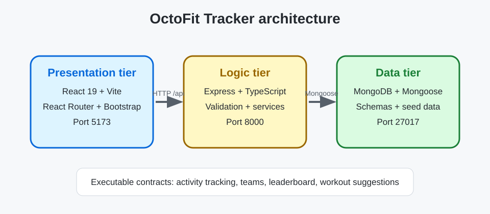

# OctoFit Tracker architecture

OctoFit Tracker is a three-tier application for a school fitness program. The starter code includes API contracts and intentionally incomplete implementation points so you can use GitHub Copilot agent mode in a test-driven loop.

## Tier boundaries

- **Presentation tier**: React 19, Vite, React Router, Bootstrap, and a shared API client in `octofit-tracker/frontend/src`.
- **Logic tier**: Express and TypeScript routes/services in `octofit-tracker/backend/src` expose `/api/*` behavior on port `8000`.
- **Data tier**: Mongoose models and seed data in `octofit-tracker/backend/src/models` and `src/scripts/seed.ts` persist to MongoDB on port `27017`.

## Ports and environment rules

- MongoDB: `27017`
- Express API: `8000`
- Vite frontend: `5173`
- The browser calls relative `/api` paths. Vite proxies them to `http://localhost:8000`, so the unauthenticated API port stays private in Codespaces. `VITE_API_BASE_URL` can override the base URL.

## API contract

| Capability | Method and path | Expected behavior |
| --- | --- | --- |
| Activity tracking | `GET /api/activities`, `POST /api/activities` | List and create valid activity records. POST accepts `userId`, `teamId`, `type`, and `minutes`; `userId` and `teamId` must be well-formed IDs for an existing user and team; otherwise respond with a deliberate 4xx (never a 500 from a cast error). A created activity stores the submitted `user`, `team`, `type`, and `minutes` plus computed `points` and `occurredAt`. |
| Teams | `GET /api/teams`, `POST /api/teams` | List and create teams with members. Created and listed teams keep the submitted `name` and `mascot`. Reject a team without a name with `400`. |
| Leaderboard | `GET /api/leaderboard` | Return teams ordered by the sum of their activity points, highest first. Each entry has `teamName`, `totalPoints`, and a 1-based `rank`. |
| Workout suggestions | `GET /api/workouts/suggestions/:userEmail` | Recommend workouts from recent activity patterns for the matching seeded user's email address. The first suggestion's `focus` matches that user's goal or recent activity, with a `reason` explaining why. An email with no matching user returns a deliberate 4xx (for example, `404`). |

## Implementation decisions

Record your plan here before editing code.

- Presentation tier decision: Keep page components focused on rendering and interaction; use the shared API client for relative `/api` requests and keep loading, empty, and error states accessible. Vite proxies API requests to Express.
- Logic tier decision: Implement the documented REST contracts in Express routes/services. Validate request data and referenced records at the API boundary, return deliberate 4xx responses for invalid or unknown inputs, and keep persistence details in the data tier.
- Data tier decision: Use Mongoose models to enforce required fields, relationships, and valid values. Keep representative seed data in the existing seed script and make seeding safe to repeat.
- Activity tracking approach: Validate activity type, minutes, and well-formed IDs for an existing user and team; persist the references, submitted values, computed points, and occurrence time.
- Team management approach: Require a team name, retain the submitted name and mascot, and store members as references to users.
- Leaderboard approach: Aggregate activity points by team, sort highest total first, and return each team name, total, and 1-based rank.
- Workout suggestions approach: Match the requested email to a seeded user, use that user's goal or recent activity to select a relevant workout focus, and explain the recommendation; return a deliberate 4xx when no user matches.

## Test plan

Record the commands you run and what each failure means.

- Data-tier command: `npm run test:data --prefix octofit-tracker/backend` — 4 failed, 1 passed. Failures show missing required-field validation on user, team, activity, and workout models; the seed-data contract passes.
- API command: `npm run test:api --prefix octofit-tracker/backend` — 4 failed. Invalid activity/team requests return 501 instead of 400, the leaderboard returns no ranked teams, and the workout suggestion lacks the expected explanatory reason.
- Frontend command: `npm test --prefix octofit-tracker/frontend` — 15 failed. The UI does not satisfy the rendering and accessible loading, empty, and error-state contracts for the tested routes.
- Backend build command: `npm run build --prefix octofit-tracker/backend` — passed (`tsc --noEmit`).
- Frontend build command: `npm run build --prefix octofit-tracker/frontend` — passed (TypeScript check and Vite production build).
